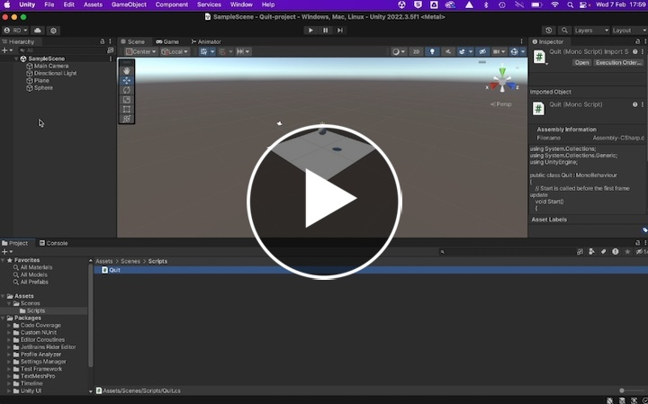

# How to build your Unity project

With Unity you create a desktop app (or mobile app) to finish and distribute a project. This is called 'building' a project, rather than exporting.   

These videos step through adding a 'quit' or 'exit' function in your Unity project as well as the process of 'building' or exporting to an executable file (a .app on Mac and .exe on Windows).     

## Quit and Build pt 1.
  

## Quit and Build pt 2.

