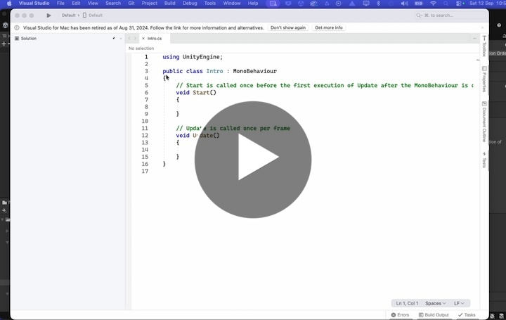
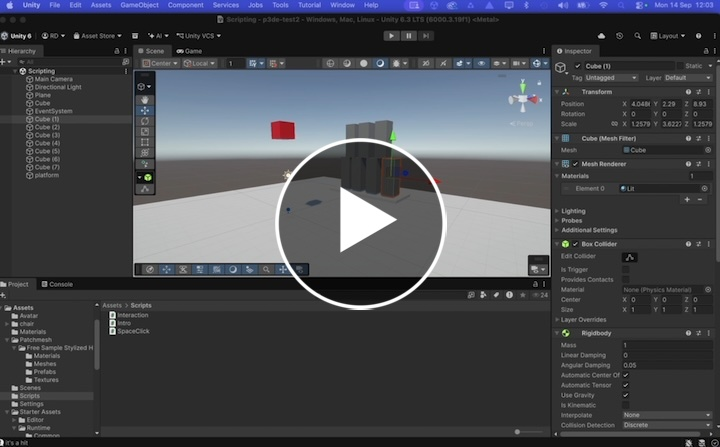
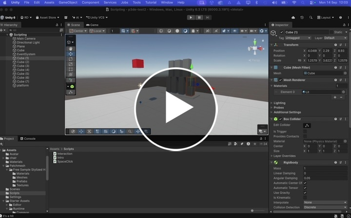

# Unity Intro to Scripting, Variables and Mouse Events

Unity uses a scripting language called C# (C Sharp). These videos will step you through how to get started with scripting.    

## Unity Scripting pt 1. Set up
  

## Unity Scripting pt 2. Anatomy of a script

## Unity Scripting pt 3. Let's get coding

## Unity Scripting pt 4. Mouse interactions

## Unity Scripting pt 5. Keyboard interactions

## Unity Scripting pt 6. Adding force and velocity

## Unity Scripting pt 7. Tags and variables

## Unity Scripting pt 8. Errors

