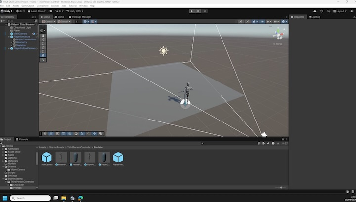
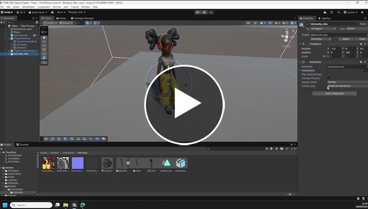
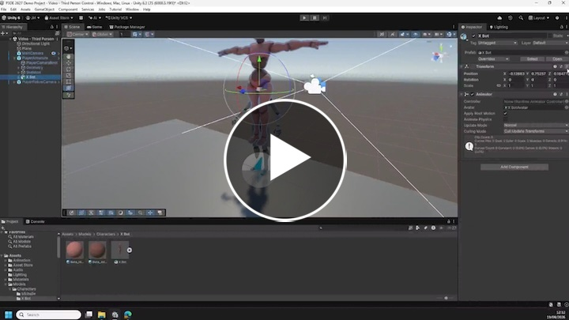
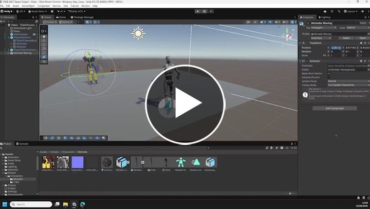
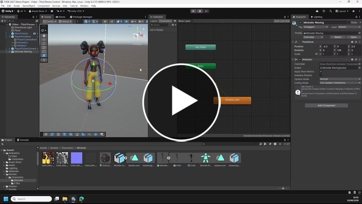

# Unity Intro to Animation and Third Person Controller

These videos will show you how to use character assets and animations from the Mixamo site and how to configure them for you own project.

These videos will show you how to add a character model from the Adobe Mixamo character library and how to add animations to the character and insert it in your scene creating a NPC.   

## Unity how to add a character model to your scene pt 1
  

## Unity how to add a character model to your scene pt 2
  

This video will show you how to add a character model or skin to your third person controller. To be to do this we will use downloadable rigged character models from the Mixamo website.   
## Unity how to add a character model or skin to your third person controller
  

The next two videos will show you how to create a sequence of animations from a collection of animation clips using an animation controller.   

## Unity how to use animation clips with an animation controller to create a sequence of animations pt1
  

## Unity how to use animation clips with an animation controller to create a sequence of animations pt2
  

